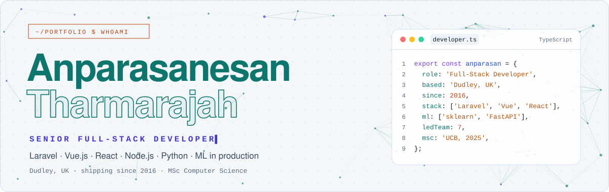
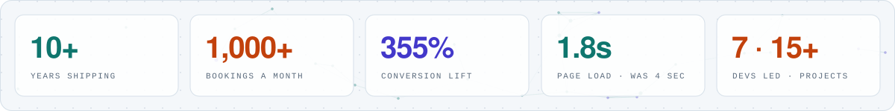
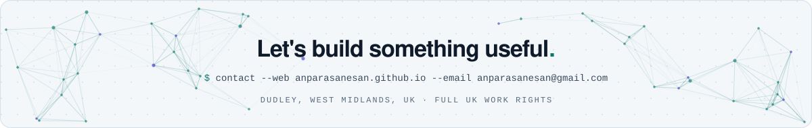

<div align="center">

<!-- ============================================================
     Anparasanesan Tharmarajah · GitHub profile
     Banner images live in /assets (light + dark versions)
     ============================================================ -->

<a href="https://anparasanesan.github.io">
<picture>
  <source media="(prefers-color-scheme: dark)" srcset="https://raw.githubusercontent.com/anparasanesan/anparasanesan/main/assets/header-dark.svg">
  
</picture>
</a>

<br>

<a href="https://anparasanesan.github.io"></a>

<br><br>

<a href="https://anparasanesan.github.io"></a>
<a href="https://www.linkedin.com/in/anparasanesan/"></a>
<a href="mailto:anparasanesan@gmail.com"></a>
<a href="https://anparasanesan.github.io/assets/Anparasanesan_Tharmarajah_CV.pdf"></a>

<br>


</div>

<br>

## `// 01` About me

I'm a **Senior Full-Stack Developer** in Dudley, West Midlands. Since 2016 I've built e-commerce, e-learning and booking platforms with **Laravel, Vue.js, React and Python** for clients in the **UK, Germany, the US and Sri Lanka**.

A few things I'm proud of: an **airport parking platform** I built from scratch still handles **1,000+ bookings a month** across four German brands. As a team lead I ran **7 developers across 15+ projects**, introduced code review and staging, and cut page loads from **4s to 1.8s**. Since 2025 I've delivered **10 freelance projects**, three of them business systems with **machine learning and AI built in**: student analytics, stock-waste forecasting and an AI travel assistant.

I hold an **MSc in Computer Science** from University College Birmingham and a **first-author ACM paper** (ICEIT 2019). I also bring SEO and paid-acquisition skills, including a **355% conversion lift** for a client.

```yaml
name:        Anparasanesan Tharmarajah
role:        Senior Full-Stack Developer
based:       Dudley, West Midlands, UK        # full UK work rights, no sponsorship needed
experience:  10 years (since 2016) · UK, Germany, US, Sri Lanka
core_stack:  [PHP, Laravel, Vue.js, React, Next.js, Node.js, TypeScript, Python]
ml_and_ai:   [scikit-learn, LightGBM, SHAP, FastAPI, Claude API, OpenAI API]
leadership:  7 developers · 15+ projects · Agile/Scrum in Jira
education:   MSc Computer Science (UCB, 2025) · BSc (Hons) IT (SLIIT, 2018)
research:    First-author ACM paper · ICEIT 2019
open_to:     full-stack and Laravel roles in the UK · freelance projects
```

<br>

## `// 02` Impact in numbers

<picture>
  <source media="(prefers-color-scheme: dark)" srcset="https://raw.githubusercontent.com/anparasanesan/anparasanesan/main/assets/impact-dark.svg">
  
</picture>

<br>

## `// 03` How I work

| Principle | In practice |
|:--|:--|
| **Ship with a safety net** | Git feature branches, peer code review and separate staging environments, so every release is traceable and easy to roll back. |
| **Run what I build** | Managed 3 production servers (VPS and AWS EC2) hosting 17 client sites: deployments, Apache and Nginx, DNS and SSL. |
| **Add ML where it pays** | Forecasting, student analytics and LLM assistants built into real products, with SHAP so the predictions can be explained. |
| **Speak the business side** | Daily work with managing directors, tutors and operations teams, plus SEO and paid ads that took client sites to page one. |

<p align="center"></p>

## `// 04` Experience

### Freelance Full-Stack Developer · Self-employed, UK
`Jan 2025 – present`

- Delivered **10 client projects** (7 websites, 3 business systems) across e-commerce, education, hospitality and travel.
- Built a **multi-tenant student management platform** (Laravel, React + TypeScript via Inertia.js, PostgreSQL, Redis) with role-based access, real-time dashboards, Stripe payments and bulk exports, plus a **FastAPI ML service** that pinpoints each student's weak topics (scikit-learn, SHAP, Claude API).
- Built a **cross-platform point of sale** (Electron, React, NestJS, PostgreSQL) with receipt printer and barcode scanner support, and a **LightGBM forecasting service** that uses weather, local events and promotions to sell near-expiry stock before it's wasted.
- Built a **tours & travel booking platform** (Next.js, TypeScript, Laravel API, PostgreSQL) with Stripe checkout, Google Maps and an **OpenAI-powered assistant** that researches destinations for agents.

**Live work:** [Hook and Line Sidcup](https://hookandlinesidcup.co.uk/) · [Fish and Chips Sidcup](https://fishandchipsidcup.co.uk/) · [My Learning Point](https://mylearningpoint.co.uk/)

### Senior Software Engineer (Team Lead) · Koceansoft (Pvt) Ltd, Sri Lanka
`Mar 2021 – Jan 2025` · part-time and remote from Sep 2023

- Led **7 developers** delivering **15+ projects** on schedule for clients in Sri Lanka and the US, running Agile/Scrum sprints in Jira from requirements to sign-off.
- Grew a client's visitor-to-paid conversion rate by **355% in 12 months** with retargeting campaigns on Facebook and Google Ads.
- Cut page loads from **4s to 1.8s** by moving front ends to lightweight Vue.js components, and standardised MVC architecture in Laravel.
- Introduced **feature branches, peer code review and staging**, ending direct edits to production.
- Took client sites to **first-page Google rankings** for priority keywords, and managed **3 production servers hosting 17 sites**.

**Live work:** [MyKings.lk](https://www.mykings.lk) · [The Smiley Gifts](https://thesmileygifts.com) · [KD Hardscape](https://kdhardscape.com) · [10xTree](https://10xtree.com) · [Jaffna College](https://jaffnacollege.lk) · [Periyapulam Maha Vidyalayam](https://www.periyapulammv.com) · plus an LMS for AIBT and private student-management and POS systems

### Software Developer · Prograva (Pvt) Ltd, Germany (remote)
`Apr 2019 – Mar 2021`

- Built an **airport parking booking platform from scratch**: online booking, slot allocation, live availability and payments. Still live across **four brands** with **1,000+ bookings a month**.
- Led the move from **Yii2 to Laravel and Vue.js**, auditing the legacy system and proposing the improvements built into the new version.
- Developed the booking module, customer dashboard and **Stripe** payments, with REST APIs on MS SQL, code in GitLab and delivery tracked in Asana.

**Live work:** [ich-parke-selber.de](https://www.ich-parke-selber.de) · [parkairport.de](https://www.parkairport.de) · [parkkoenig.de](https://www.parkkoenig.de) · [primus-parken.de](https://primus-parken.de)

### Senior Web Developer · Global Edulink (UK-based), Battaramulla, Sri Lanka
`Jul 2016 – Jan 2019`

- Managed a **team of 4** to design, build and run **six UK e-learning platforms** that together generated around **£85K in monthly sales**.
- Built core LMS features in PHP, Laravel and WordPress (course delivery, online payments, automated certificates, email and marketing integrations) supporting **10–15 new enrolments a day**.
- Launched cross-platform **Ionic mobile apps** that reached **1,000+ student downloads in 3 months**, and owned SEO and site performance.

**Live work:** [Global Edulink](https://www.globaledulink.co.uk) · [Study365](https://www.study365.co.uk) · [South London College](https://www.southlondoncollege.org) · [1Training](https://www.1training.org) · [Studyfolk Exams](https://www.studyfolkexams.com)

<p align="center"></p>

## `// 05` Projects

<table>
<tr>
<td width="50%" valign="top">

### At-risk Student Prediction
<sub>MSc research prototype · Python · Flask</sub>

Random Forest model that flags students at risk of falling behind, served through a Flask web app and a JSON API, alongside 13 ML experiments for education: BERT essay grading, GPT-2 feedback, sentiment analysis, recommendations and Q-learning adaptive content.

`Python` `scikit-learn` `Flask` `TensorFlow` `Hugging Face` `pandas`

<a href="https://github.com/anparasanesan/at-risk-student-prediction"></a>

</td>
<td width="50%" valign="top">

### Face Access Control
<sub>MSc AI/ML module · Python · Streamlit</sub>

Visitor access web app: enrol a face, then validate visitors from a webcam photo using 128-dimension deep-learning face encodings, a tunable similarity threshold and a full visit log. Privacy-first, with no real faces in the repo.

`Python` `OpenCV` `dlib` `face_recognition` `Streamlit` `pandas`

<a href="https://github.com/anparasanesan/Facial_recognition"></a>

</td>
</tr>
<tr>
<td width="50%" valign="top">

### Student Management Platform + ML
<sub>Client project · 2025 · code private</sub>

Multi-tenant platform with role-based access, real-time dashboards, Stripe payments and bulk exports. A FastAPI service pinpoints each student's weak topics, recommends study actions and explains why with SHAP.

`Laravel` `React` `Inertia.js` `TypeScript` `PostgreSQL` `Redis` `FastAPI` `Claude API`

</td>
<td width="50%" valign="top">

### Point of Sale + Waste Forecasting
<sub>Client project · 2025 · code private</sub>

Cross-platform POS with receipt printer and barcode scanner support. A LightGBM service uses weather, local events, promotions and market trends to suggest how to sell near-expiry stock before it goes to waste.

`Electron` `React` `NestJS` `PostgreSQL` `Python` `LightGBM`

</td>
</tr>
<tr>
<td width="50%" valign="top">

### Tours & Travel Booking + AI Assistant
<sub>Client project · 2025 · code private</sub>

Next.js front end on a Laravel API with Stripe checkout and Google Maps. An OpenAI-powered chatbot answers customer questions and researches destinations to give agents ready-made suggestions.

`Next.js` `TypeScript` `Laravel` `PostgreSQL` `Stripe` `OpenAI API`

</td>
<td width="50%" valign="top">

### Airport Parking Platform
<sub>Prograva · 2019–2021 · live</sub>

Built from scratch for a German operator: online booking, slot allocation, live availability and payments. Still live on four brands with 1,000+ bookings a month.

`Laravel` `Vue.js` `MS SQL` `Stripe` `REST APIs` `GitLab`

<a href="https://www.ich-parke-selber.de"></a>

</td>
</tr>
<tr>
<td width="50%" valign="top">

### ParkSpace Booking
<sub>Portfolio project · in progress</sub>

Car park booking app built the way I'd build it for a client: Laravel with Vue via Inertia, Stripe test payments, Pest tests and GitHub Actions CI on every pull request. The repo goes public once it's ready.

`Laravel` `Vue.js` `Inertia.js` `TypeScript` `Tailwind CSS` `Pest`

</td>
<td width="50%" valign="top">

### This Portfolio Site
<sub>Hand-built · HTML, CSS & JavaScript</sub>

Light and dark themes, a live connecting-dots background, a working in-page shell, skill matrix and radar chart, with no framework and no build step. Hosted on GitHub Pages.

`HTML5` `CSS3` `JavaScript` `Canvas API` `GitHub Pages`

<a href="https://anparasanesan.github.io"></a>
<a href="https://github.com/anparasanesan/anparasanesan.github.io"></a>

</td>
</tr>
</table>

## `// 06` Research & publications

**Smart Monitor for Tracking Child's Brain Development** · *First author*<br>
8th International Conference on Educational and Information Technology (**ICEIT 2019**), ACM, March 2019.<br>
A mobile app that uses machine learning and gamification to track and support children's cognitive development.<br>
<a href="https://doi.org/10.1145/3318396.3318401"></a>

**Enhancing Lecturer Productivity in Higher Education through Machine Learning** · *MSc dissertation, manuscript in preparation*<br>
University College Birmingham, 2025. Explores automated grading, at-risk student prediction and personalised learning; the prototype code is in [at-risk-student-prediction](https://github.com/anparasanesan/at-risk-student-prediction).

<p align="center"></p>

## `// 07` Tech stack

<div align="center">

**Build**

<picture>
  <source media="(prefers-color-scheme: dark)" srcset="https://skillicons.dev/icons?i=php,laravel,js,ts,vue,react,nextjs,nodejs,nestjs,electron,tailwind,bootstrap,html,css,wordpress&theme=dark&perline=15">
  
</picture>

**Data, cloud & DevOps**

<picture>
  <source media="(prefers-color-scheme: dark)" srcset="https://skillicons.dev/icons?i=mysql,postgres,redis,firebase,aws,docker,nginx,linux,git,github,gitlab&theme=dark">
  
</picture>

**Machine learning & AI**

<picture>
  <source media="(prefers-color-scheme: dark)" srcset="https://skillicons.dev/icons?i=py,fastapi,flask,sklearn,opencv&theme=dark">
  
</picture>

<br><br>

`Yii2` `Inertia.js` `Filament` `Ionic` `WooCommerce` `MS SQL` `VPS hosting` `Apache` `cPanel/WHM` `DNS & SSL`<br>
`LightGBM` `SHAP` `pandas` `Streamlit` `NLP` `Predictive modelling` `Claude API` `OpenAI API`<br>
`Stripe` `REST APIs` `Google Maps API` `Agile/Scrum` `Code review` `Jira` `Asana` `Teamwork`<br>
`Technical SEO` `Keyword research` `Google Analytics` `Search Console` `Tag Manager` `Google Ads` `Meta Ads` `YouTube Ads` `Mailchimp`

</div>

## `// 08` Education

| Qualification | Where | When |
|:--|:--|:--|
| **MSc Computer Science** · dissertation on machine learning for lecturer productivity | University College Birmingham, UK | Sep 2023 – Jan 2025 |
| **BSc (Hons) Information Technology** · part-time from 2016 alongside full-time work | Sri Lanka Institute of Information Technology (SLIIT) | Jan 2014 – Dec 2018 |
| **Volunteer Lecturer** · taught 40+ students on the Uki coding programme | Yarl IT Hub, Jaffna | 2022 |

## `// 09` Right now

```bash
$ cat now.md
```

- Building **ParkSpace Booking** milestone by milestone; the repo goes public once it's ready
- Studying for certifications, which will be listed here as I complete them
- Writing the first posts for the blog on [my portfolio](https://anparasanesan.github.io/#blog)

<br>

<div align="center">

<a href="https://anparasanesan.github.io">
<picture>
  <source media="(prefers-color-scheme: dark)" srcset="https://raw.githubusercontent.com/anparasanesan/anparasanesan/main/assets/footer-dark.svg">
  
</picture>
</a>

<a href="https://anparasanesan.github.io"></a>
<a href="https://www.linkedin.com/in/anparasanesan/"></a>
<a href="mailto:anparasanesan@gmail.com"></a>
<a href="https://anparasanesan.github.io/assets/Anparasanesan_Tharmarajah_CV.pdf"></a>

</div>
